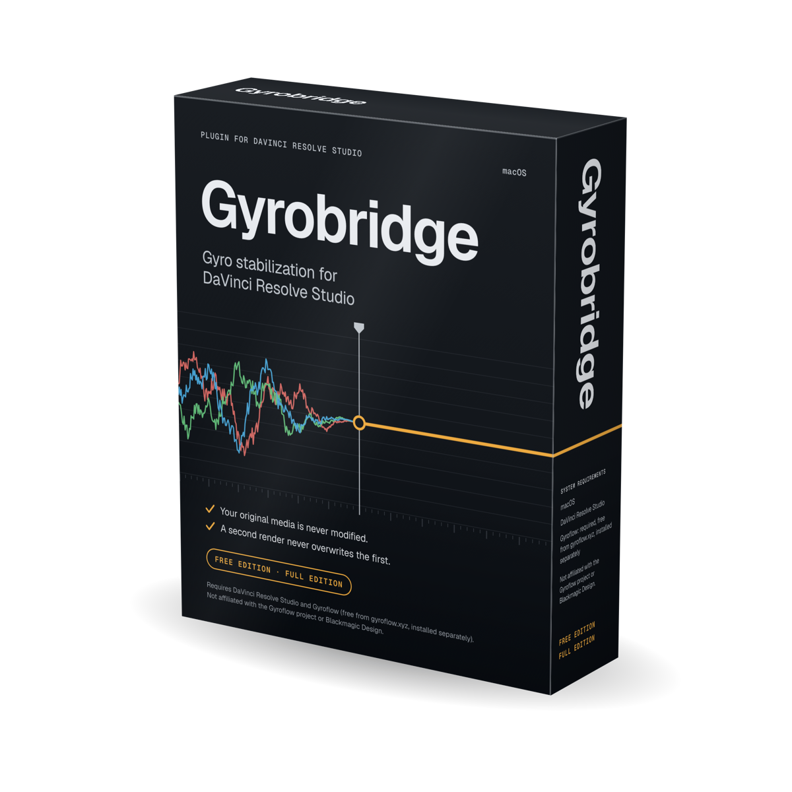

# Gyrobridge — Gyroflow stabilization inside DaVinci Resolve

Stabilize gyro-equipped footage without leaving DaVinci Resolve. Select clips, click **Stabilize**,
and Gyrobridge runs [Gyroflow](https://gyroflow.xyz) in the background on each clip, renders the
result outside Resolve, and brings the stabilized copy back into your media pool — marked so you
can see at a glance what has been processed.

**Your original media is never modified.** Every stabilized render is a new file next to the
original, and a second render never overwrites the first.

> **Download:** coming soon. Watch or star this repository to be notified of the first release.

## What you get

| | Free Edition | Full Edition |
|---|:---:|:---:|
| Stabilize from **Workspace → Scripts** | ✓ | ✓ |
| Only offers clips that actually carry gyro data | ✓ | ✓ |
| Smoothness, field of view and zoom limit | ✓ | ✓ |
| Stabilized copy added to the media pool as a new clip | ✓ | ✓ |
| Processed clips marked (colour, name suffix, comment) | ✓ | ✓ |
| Live progress | ✓ | ✓ |
| Several clips in one run | one at a time | ✓ |
| Horizon lock | | ✓ |
| Automatically picks the shakiest part to preview | | ✓ |
| Preview and side-by-side comparison | | ✓ |
| Codec choice and saved presets | | ✓ |
| Swap the stabilized clip into your timeline | | (coming) |
| Workflow Integration panel (timeline-style UI) | | (coming) |

The Free Edition is free. The Full Edition is a one-time purchase, unlocked with a licence key
inside the panel.

## Requirements

- **macOS**
- **DaVinci Resolve Studio**
- **Gyroflow** from [gyroflow.xyz](https://gyroflow.xyz) (tested with 1.6.3)
- For the Workflow Integration panel: **Python 3.9 or later** (the one built into macOS works, or
  python.org / Homebrew)

## How it works

Gyrobridge reads the gyroscope data your camera recorded, hands each clip to the Gyroflow
command-line renderer, and imports the finished file. Nothing is rendered by Resolve itself, so
your timeline and Deliver page are left alone while it works.

## Not affiliated

Gyrobridge is an independent product by Crossroads Technologies, LLC. It is not affiliated with or
endorsed by the Gyroflow project or by Blackmagic Design. Gyroflow is a separate program under the
GNU GPL v3 and is not included with Gyrobridge. DaVinci Resolve is a trademark of Blackmagic
Design Pty Ltd.

© Crossroads Technologies, LLC. Licence terms will accompany the first release.
